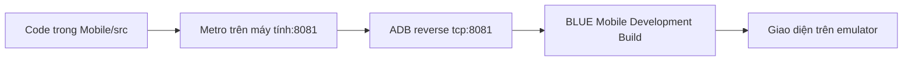

# BLUE Mobile — cài đặt, chạy app và sử dụng

**Đọc trước:** [Sơ đồ và luồng màn hình](docs/technical/SCREEN_FLOWS.md) · [Yêu cầu người dùng và quy tắc khóa/mở](docs/technical/USER_REQUIREMENTS.md).

Ứng dụng frontend **React Native + TypeScript + Expo Development Build**, một app cho Customer và Driver. Hiện chạy với dữ liệu mock phía app; không cần dựng BE, SQL hoặc database để xem giao diện. Hướng dẫn dưới đây dùng **Windows PowerShell và Android Emulator**. Đây là bản development cần Metro, chưa phải APK production phát hành độc lập.

## 0. Lấy mã nguồn

Cài Git nếu máy chưa có, mở terminal tại thư mục muốn lưu dự án:

```powershell
git clone https://github.com/BapTruongSinh/mock_pbl6_mobile.git
cd mock_pbl6_mobile
```

Các lệnh bên dưới chạy tại **thư mục gốc dự án** (nơi có package.json). Khi mở terminal thứ hai, mở tại cùng thư mục này. Có thể đặt project ở bất kỳ ổ đĩa/thư mục nào; không cần dùng đường dẫn của người phát triển ban đầu.

## 1. Chạy nhanh khi máy đã cài đủ và app đã có trên emulator

1. Android Studio → **Device Manager** → bấm ▶ để mở emulator, chờ vào màn hình Android.
2. Mở PowerShell thứ nhất tại Mobile và giữ terminal này chạy:

```powershell
pnpm dev --port 8081
```

3. Mở PowerShell thứ hai:

```powershell
# Ưu tiên SDK đã cấu hình; nếu chưa có, dùng vị trí mặc định trên Windows.
$sdkDir = if ($env:ANDROID_HOME) { $env:ANDROID_HOME } else { Join-Path $env:LOCALAPPDATA 'Android\Sdk' }
$adb = Join-Path $sdkDir 'platform-tools\adb.exe'
if (!(Test-Path $adb)) { throw 'Chọn lại sdkDir theo Android SDK Location trong Android Studio.' }
& $adb devices -l
```

Chọn serial có trạng thái `device` trong kết quả:

```powershell
$device = Read-Host 'Nhập serial emulator trong danh sách adb devices'
& $adb -s $device reverse tcp:8081 tcp:8081
& $adb -s $device shell am start -a android.intent.action.VIEW -d 'exp+blue-mobile://expo-development-client/?url=http://127.0.0.1:8081' vn.blue.mobile
```

Chờ Metro bundle xong. App sẽ hiện Welcome hoặc màn theo phiên đăng nhập đã lưu. Nếu chưa cài BLUE Mobile, làm mục 2–5 trước.

## 2. Cài công cụ lần đầu

| Công cụ              | Cấu hình của dự án                                                                              |
| -------------------- | ----------------------------------------------------------------------------------------------- |
| Node.js              | Nhánh **24.x**, yêu cầu `>=24.3.0 <25`; `.node-version` hiện là `24.22.0`                       |
| pnpm                 | **11.25.0**, theo `packageManager` trong package.json                                           |
| Java                 | **JDK 21**; cấu hình JAVA_HOME theo vị trí cài trên máy bạn                                     |
| Android Studio       | Cài IDE và SDK Manager/Device Manager; không tạo dự án Android mới đè lên Mobile                |
| SDK Platform         | **Android API 36** để compile                                                                   |
| SDK Build-Tools      | **36.0.0**                                                                                      |
| SDK Tools            | Platform-Tools, Android Emulator, Command-line Tools; NDK **27.1.12297006** theo build hiện tại |
| Emulator đã kiểm tra | Android 14 / **API 34**, Google APIs **x86_64**; Pixel 5 và Resizable                           |

API 36 dùng **build app**, API 34 là **Android chạy trong emulator**; hai số này không cần giống nhau. `android.builder.sdkDownload=false` trong project nên SDK/NDK build cần có sẵn trước khi chạy Gradle.

- Tải Node từ [trang chính thức](https://nodejs.org/en/download), chọn nhánh 24.x phù hợp dự án.
- Tải Android Studio từ [Android Developers](https://developer.android.com/studio).
- Trong Android Studio → **SDK Manager**: cài platform/tool nêu trên. Xem đường dẫn **Android SDK Location** để dùng trong lệnh bên dưới.
- Cài JDK 21 nếu máy chưa có. `JAVA_HOME` phải trỏ tới thư mục JDK thực tế, không phải thư mục `bin`.

Kiểm tra trong PowerShell mới:

```powershell
node --version
npm --version
java -version
```

Nếu chưa có đúng pnpm, cài bằng npm rồi mở lại PowerShell:

```powershell
npm install --global pnpm@11.25.0
pnpm --version
```

Không bắt buộc dùng `nvm`. Lỗi “nvm is not recognized” chỉ có nghĩa máy chưa có công cụ quản lý phiên bản đó; có thể cài trực tiếp Node 24.x. Không bỏ `engine-strict` để chạy với Node không tương thích.

## 3. Tạo emulator trong Android Studio

Tại màn Welcome: **More Actions → Virtual Device Manager**; khi đã mở project: **View → Tool Windows → Device Manager**.

1. Chọn **Create Virtual Device / Add Device**.
2. Chọn **Pixel 5** để review điện thoại. Có thể tạo thêm **Resizable (Experimental)** để thử màn rộng.
3. Chọn system image **API 34 / Android 14 → Google APIs → x86_64**, tải nếu chưa có.
4. Đặt tên, ví dụ `BLUE_Mobile_API34`; Finish rồi bấm ▶.
5. Chờ Android khởi động hoàn tất. Dùng `adb devices -l` để lấy serial thật; số `5554/5556` có thể đổi giữa các phiên.

Có thể dùng lại AVD đã có nếu đúng API/kiến trúc, không cần đặt trùng tên ví dụ. Thay đổi kích thước bằng các chế độ của emulator Resizable hoặc AVD khác. Mục **Add secondary display** là tạo màn hình phụ, không phải đổi kích thước màn chính. App dùng chiều rộng cửa sổ thiết bị và cho cuộn dọc khi nội dung dài.

## 4. Cài dependency và cấu hình đường dẫn

```powershell
pnpm install --frozen-lockfile
```

Giữ nguyên lockfile. `pnpm-workspace.yaml` dùng đường dẫn tương đối trong `.cache/` của project, không phụ thuộc ổ đĩa hoặc tên tài khoản Windows.

Đặt biến cho terminal đang dùng (sửa đường dẫn theo máy của bạn):

```powershell
if (!$env:JAVA_HOME) {
    $env:JAVA_HOME = Read-Host 'Nhập đường dẫn thư mục JDK 21 đã cài (không gồm bin)'
}
& (Join-Path $env:JAVA_HOME 'bin\java.exe') -version
$sdkDir = if ($env:ANDROID_HOME) { $env:ANDROID_HOME } else { Join-Path $env:LOCALAPPDATA 'Android\Sdk' }
# Nếu SDK nằm nơi khác, thay sdkDir bằng Android SDK Location trong SDK Manager.
$env:ANDROID_HOME = $sdkDir
$adb = Join-Path $sdkDir 'platform-tools\adb.exe'
& $adb devices -l
```

### Khi đã có thư mục android

Native build đọc SDK từ `android/local.properties`. Khi mới tạo native project hoặc cấu hình SDK còn trỏ sang máy khác, ghi đường dẫn SDK của **máy đang dùng**:

```powershell
Set-Content -LiteralPath .\android\local.properties -Value ('sdk.dir=' + $sdkDir.Replace('\', '/'))
```

`local.properties` là cấu hình riêng máy; không copy nguyên đường dẫn của máy khác.

### Khi bản source tải về chưa có thư mục android

`android/` hiện bị ignore trong `.gitignore`, nên bản source nhận từ Git có thể chưa chứa native project. Tạo lại sau khi cài dependency:

```powershell
pnpm exec expo prebuild --platform android --no-install
```

Sau đó mới ghi `android/local.properties` như trên. Không chạy `prebuild --clean` hoặc tạo project mới chỉ để sửa giao diện; thao tác đó có thể ghi lại cấu hình native.

## 5. Build và cài app lên emulator

Emulator phải đang mở. Trong PowerShell tại Mobile, sau khi đặt `JAVA_HOME` đúng:

```powershell
pnpm android:branding
.\android\gradlew.bat -p android :app:assembleDebug --max-workers=2 -PreactNativeArchitectures=x86_64 --console=plain
```

`pnpm android:branding` đồng bộ icon BLUE và splash native từ asset gốc; chạy lại sau mỗi lần Expo prebuild để giữ đúng nhận diện. Chỉ tiếp tục nếu có **BUILD SUCCESSFUL**. APK nằm tại:

```text
android/app/build/outputs/apk/debug/app-debug.apk
```

Cài lên thiết bị đã chọn:

```powershell
$device = Read-Host 'Nhập serial emulator trong danh sách adb devices'
& $adb -s $device install -r .\android\app\build\outputs\apk\debug\app-debug.apk
```

Kết quả phải là **Success**. `-r` cập nhật app và thường giữ dữ liệu cũ; không cần gỡ app mỗi lần. APK lệnh trên chỉ build **x86_64 cho emulator**, không phải bản để cài lên mọi điện thoại thật.

Có thể mở native project trong Android Studio bằng **Open → chọn thư mục android bên trong project vừa clone**, đặt **Gradle JDK = JDK 21**, chọn emulator rồi Run. Các file React Native/TypeScript vẫn ở `src/`; phần SDK/Gradle cần trùng cấu hình ở trên.

## 6. Nạp Metro và code vào app

Metro là server đóng gói và gửi JavaScript/TypeScript của project cho Development Build.

- Terminal A: `pnpm dev --port 8081`, giữ chạy trong thư mục Mobile.
- Terminal B: ADB reverse và mở development URL như mục 1.
- Nếu app hiện màn **BLUE Mobile / Development Build / Development servers**, đó là launcher. Mở URL bằng lệnh ADB hoặc nhập `http://127.0.0.1:8081` vào ô kết nối sau khi đã reverse rồi bấm Connect.



### Hai emulator cùng lúc

Sau khi app đã cài trên các emulator muốn review, nhập những serial đã chọn từ `adb devices -l`, cách nhau bằng dấu cách:

```powershell
$selectedDevices = (Read-Host 'Nhập serial emulator muốn kết nối, cách nhau bằng dấu cách') -split '\s+'
foreach ($device in $selectedDevices) {
    & $adb -s $device reverse tcp:8081 tcp:8081
    & $adb -s $device shell am start -a android.intent.action.VIEW -d 'exp+blue-mobile://expo-development-client/?url=http://127.0.0.1:8081' vn.blue.mobile
}
```

Một Metro phục vụ được cả hai app. Mỗi emulator giữ dữ liệu/phiên riêng. Terminal A có thể nhấn `r` để reload các app đang kết nối. Giữ emulator chạy giữa các lượt làm việc; chỉ khởi động lại khi thực sự bị treo.

### Khi nào cần build lại?

| Thay đổi                                                                | Cách cập nhật                                                                         |
| ----------------------------------------------------------------------- | ------------------------------------------------------------------------------------- |
| TSX, hook, style native, fixture, tài liệu                              | Lưu file; Fast Refresh hoặc nhấn `r` trong Metro để cập nhật code                     |
| Thêm thư viện có native code, đổi permission/native config, sửa Android | Cài dependency phù hợp, cập nhật native config cần thiết, build lại APK và install -r |
| Chỉ tắt/mở lại app development                                          | Chạy Metro, reverse lại nếu cần, mở development URL                                   |

Development Build khác Expo Go; dùng app **BLUE Mobile** đã build cho project này. APK development hiện tại cần Metro để nạp code; hướng dẫn này chưa bao gồm ký release APK/AAB hoặc đưa lên Play Store. Xem [hướng dẫn Development Build của Expo](https://docs.expo.dev/develop/development-builds/use-development-builds/).

## 7. Sử dụng app

### Tài khoản mock

| Vai trò    | Email ban đầu | Mật khẩu ban đầu | Kết quả                      |
| ---------- | ------------- | ---------------- | ---------------------------- |
| Khách hàng | `a@gmail.com` | `12345678`       | Minh Anh, giao diện Customer |
| Tài xế     | `b@gmail.com` | `12345678`       | Hoàng Nam, giao diện Driver  |

Đây là tài khoản demo local. Nếu đã đổi email/mật khẩu trong app, dùng thông tin mới trên **đúng emulator** đó. Không tự reset dữ liệu để lấy lại thông tin cũ.

- Chưa có phiên: Welcome → Bắt đầu hành trình → Login chung. App tự chọn giao diện theo role, không có bộ chọn role.
- **Guest:** Tiếp tục với tư cách khách → Tra cứu vé hoặc Xem chuyến. Tra cứu có form và camera QR; màn kết quả Guest hiện còn chờ triển khai.
- **Customer:** Tìm chuyến → lọc → chọn chuyến/ghế → thông tin từng hành khách → thanh toán VNPay mock → vé điện tử. Guest được xem/chọn ghế nhưng cần đăng nhập trước đặt/thanh toán.
- **Thanh toán demo:** “Tôi đã chuyển tiền” chỉ sang chờ xác nhận. Dùng “Giả lập hệ thống xác nhận thành công” để xuất vé trong bản mock; không chuyển tiền thật theo QR mô phỏng.
- **Vé:** tab Vé → Vé của tôi → chọn vé → vé điện tử → tải ảnh vé kèm QR hoặc hủy vé. Quay lại chi tiết vé về danh sách, không quay lại thanh toán.
- **Hủy/hoàn:** chọn một/nhiều vé → xem phí → xác nhận → chờ ghi nhận hủy → VNPay đang xử lý → kết quả hoàn tiền giả lập. Không coi bấm nút là đã hoàn tiền.
- **Driver:** Lộ trình → chuyến → xác nhận bắt đầu đón → danh sách hành khách → kiểm tra QR hoặc nhập mã. Chưa đón: nút kiểm vé khóa; đang đón/đang chạy: mở; đến nơi/hoàn thành: ẩn.
- **Driver chuyển trạng thái:** xác nhận từng bước xuất bến → đến nơi → hoàn thành; có điều kiện giờ và thời lượng. Bản development có nút giả lập đủ giờ; không cần chờ nhiều giờ để review.
- **Tài khoản:** Customer sửa email/SĐT/ngày sinh/avatar/mật khẩu; Driver sửa email/avatar/mật khẩu, SĐT/ngày sinh chỉ xem. Tuổi tự tính từ ngày sinh.

Mã kiểm vé Driver giả lập: `TVL-9K2C-7M4Q` (A02 hợp lệ), nhập lại báo đã soát. Mã này chỉ dùng với fixture/chuyến tương ứng, không phải vé thật. Chi tiết các mã sai/hủy/hoàn trong [DRIVER_MANIFEST_CHECKIN.md](docs/technical/DRIVER_MANIFEST_CHECKIN.md).

### Review thẳng một màn

Trong bản development, với phiên có role phù hợp:

```powershell
& $adb -s $device shell am start -a android.intent.action.VIEW -d 'bluemobile://debug/case/FIGMA-1140-18' vn.blue.mobile
```

Ví dụ: `FIGMA-650-4` Welcome; `FIGMA-64-634` Login; `FIGMA-64-638` Register; `NEW-CUSTOMER-ACCOUNT` tài khoản; `DRIVER-ACCOUNT`; `FIGMA-1137-18` danh sách khách; `FIGMA-1140-18` xác nhận đón khách. Link dùng component thật với fixture review, không phải bản copy UI và không đổi quyền tài khoản.

Để quay về luồng app bình thường sau review, đóng riêng BLUE Mobile rồi mở lại qua development URL; không cần tắt emulator:

```powershell
& $adb -s $device shell am force-stop vn.blue.mobile
& $adb -s $device shell am start -a android.intent.action.VIEW -d 'exp+blue-mobile://expo-development-client/?url=http://127.0.0.1:8081' vn.blue.mobile
```

## 8. Lỗi thường gặp

| Hiện tượng                                  | Xử lý                                                                                                                |
| ------------------------------------------- | -------------------------------------------------------------------------------------------------------------------- |
| Node không tương thích                      | `node --version`, cài/chọn Node 24.x; mở terminal mới rồi cài lại dependency                                         |
| Không tìm thấy pnpm/nvm                     | Cài pnpm đúng phiên bản; nvm là tùy chọn, không phải điều kiện bắt buộc                                              |
| ADB báo more than one device                | Luôn thêm `-s <serial>` lấy từ `adb devices -l`                                                                      |
| ADB không thấy emulator                     | Chờ Android boot xong, kiểm SDK/đường dẫn adb; mở lại kết nối trước khi nghĩ tới cài lại app                         |
| Chỉ thấy Development servers                | Metro chưa chạy hoặc app chưa kết nối; chạy mục 6, reverse và mở URL                                                 |
| Không kết nối được 8081                     | Kiểm Metro ở đúng Mobile, đúng port; reverse lại, mở lại development URL                                             |
| Cổng 8081 đã dùng                           | Kiểm terminal Metro đang chạy có đúng project không; dùng lại đúng Metro hoặc Ctrl+C ở terminal đó rồi khởi động lại |
| Code cũ chưa cập nhật                       | Lưu file, nhấn r; nếu cần Ctrl+C Metro rồi `pnpm dev --port 8081 --clear`, kết nối lại app                           |
| SDK/JDK/NDK thiếu                           | Kiểm JAVA_HOME, SDK Location, local.properties và đúng phiên bản SDK Tools; không tự hạ version để bỏ lỗi            |
| Emulator thiếu `libandroid-emu-metrics.dll` | Đóng emulator lỗi, SDK Manager → SDK Tools → cài lại Android Emulator; giữ AVD/dữ liệu                               |
| Studio lỗi `.port`/`.lock`                  | Đóng các tiến trình Studio treo trước rồi mở lại; chưa cần Reset Settings & Plugins hoặc xóa AVD                     |
| Góc màn hình đen khi thử kích thước         | Kiểm secondary display/letterbox, profile và orientation; chụp app để phân biệt emulator với lỗi layout              |
| Driver không quét được                      | Kiểm trạng thái chuyến, phân công/phiên, quyền camera và kết nối; không bật lại nút bằng cách bỏ guard               |
| Sai email/mật khẩu demo                     | Có thể đã đổi trên emulator đó; dùng định danh mới. Chỉ reset app data khi chủ ý xóa dữ liệu demo                    |

Có thể kiểm port bằng `Get-NetTCPConnection -LocalPort 8081 -State Listen`. Không chạy xóa data/cache hoặc kill mọi tiến trình Java/Node để chữa một lỗi chưa xác định.

## 9. Kiểm tra code và tài liệu liên quan

```powershell
pnpm typecheck
pnpm lint
pnpm test --runInBand
pnpm test:coverage
pnpm format:check
```

Chạy từng lệnh và đọc kết quả thật. Toàn bộ suite có thể báo lỗi ngoài phạm vi thay đổi; không lấy kết quả task cũ để báo mọi test đang pass. Lệnh smoke/native trong package.json phục vụ workflow kiểm thử riêng, có thể thao tác/reload app; không bắt buộc chạy chỉ để mở app xem giao diện.

- [Luồng màn hình và sơ đồ](docs/technical/SCREEN_FLOWS.md)
- [Tổng hợp yêu cầu, khóa/mở và phần còn thiếu](docs/technical/USER_REQUIREMENTS.md)
- [Phạm vi và quy tắc nghiệp vụ công khai](docs/technical/USER_REQUIREMENTS.md)
- [Tài khoản, xác nhận chuyến và các case Driver](docs/technical/DRIVER_ACTIONS_AND_ACCOUNT.md)
- [Danh sách khách và kiểm tra vé](docs/technical/DRIVER_MANIFEST_CHECKIN.md)
- [Đặt vé](docs/technical/BOOKING_NGUYEN_KIM.md), [vé/tải ảnh](docs/technical/TICKETS_AND_DOWNLOAD.md), [hủy/hoàn](docs/technical/CANCELLATION_REFUND.md)
- [Bàn giao API dự kiến](docs/technical/API_HANDOFF.md) — khi BE sẵn sàng
- Các rule/plan và cấu hình riêng của agent không nằm trong repo công khai. Để tiếp tục tích hợp, đọc yêu cầu nghiệp vụ, flow, domain contract và API handoff trong docs/technical.

Tài liệu đã đối chiếu source/config và log build ngày 31/10/2026. Thiết lập AVD tham khảo [Android Developers](https://developer.android.com/studio/run/managing-avds). Phiên bản package thực tế xem package.json/pnpm-lock.yaml; không thay bằng phiên bản mới nhất chỉ vì trang tải đang đề xuất.
