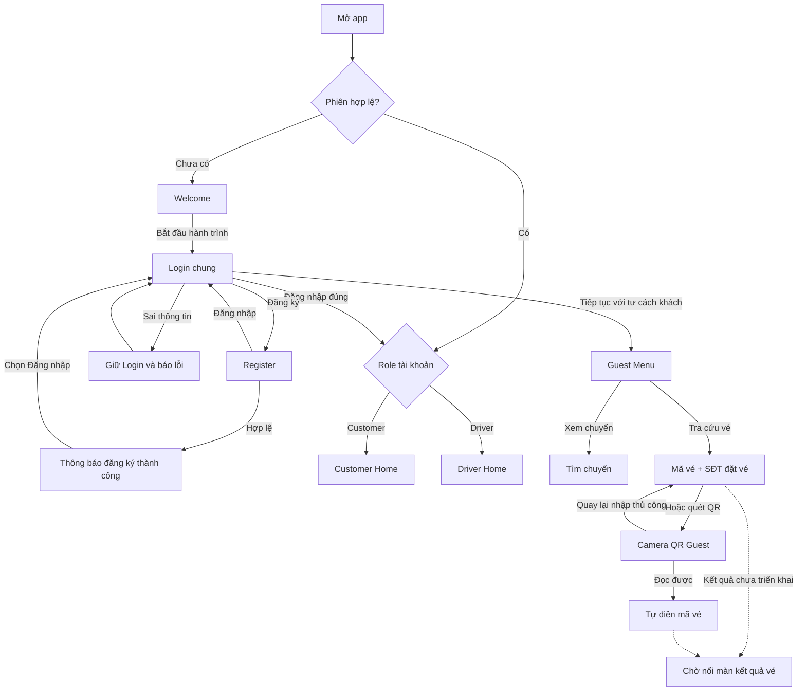
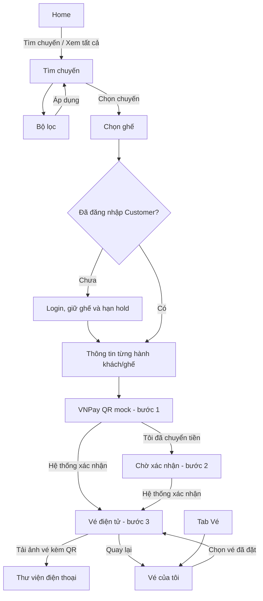
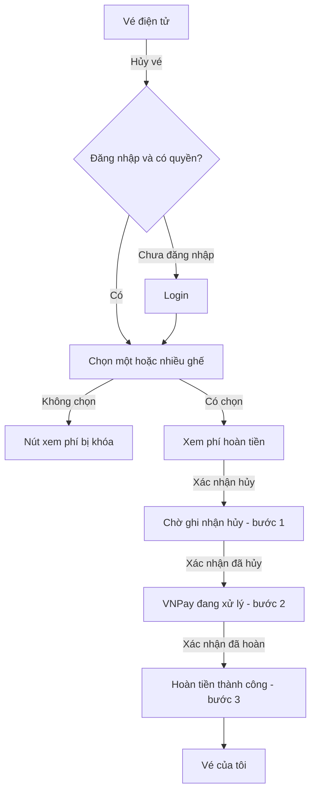
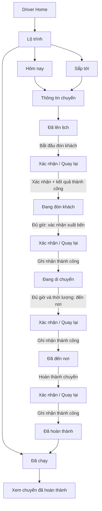
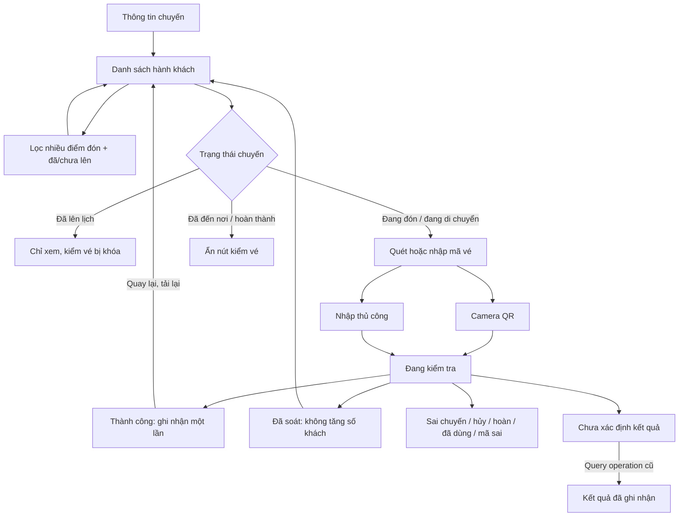

# BLUE Mobile — sơ đồ và luồng màn hình hiện hành

Cập nhật theo source và yêu cầu đã chốt ngày 31/10/2026. Đây là luồng frontend mock, không chứng nhận API production. [Hướng dẫn chạy](../../README.md) · [Yêu cầu và quy tắc khóa/mở](USER_REQUIREMENTS.md).

## 1. Mở app, đăng nhập và Guest

Login và Register giữ màn khi thiếu/sai thông tin. Đăng ký thành công hiện thông báo tại Register; không mô tả là tự chuyển trang nếu chưa có. Facebook/Google/Quên mật khẩu hiện mô phỏng, chưa tích hợp thật. Guest thủ công yêu cầu mã vé + SĐT, không OTP; QR không bắt nhập lại SĐT, nhưng màn kết quả Guest còn chờ.

## 2. Customer: tìm chuyến → đặt vé → vé của tôi

- Bốn tab Customer: Trang chủ / Tìm kiếm / Vé / Tài khoản. Home avatar MA → Tài khoản.
- Booking dùng chung cho toàn bộ fixture chuyến; sơ đồ Nguyễn Kim 34 chỗ là mock tham chiếu. Mỗi ghế có tên/SĐT riêng, tối đa 6 ghế, giữ chỗ 10 phút.
- Nút Tôi đã chuyển tiền không xác nhận thanh toán thành công. Có nút development giả lập hệ thống xác nhận; QR không dùng chuyển tiền thật.
- Vé điện tử mở lại từ danh sách dùng cùng component vé sau thanh toán; Back không quay lại payment. Xuất ảnh PNG vé kèm QR vào thư viện; không gọi là PDF.
- Vé demo đang lưu theo bộ nhớ phiên, không cam kết giữ qua reload/logout.

## 3. Hủy vé và hoàn tiền

Ghế hủy sáng, ghế không hủy xám/ghi Không hủy. Hủy một phần giữ ghế còn lại; hủy toàn bộ làm QR hết hiệu lực. Màn khách dùng thông báo nghiệp vụ, không ghi “BE xác nhận”. Các xác nhận trên hiện do mock, chính sách phí chưa là contract production.

## 4. Driver: lịch chuyến và vận hành

Mỗi Xác nhận đi qua màn đang gửi; chưa có kết quả thì không tự đổi trạng thái. Quay lại giữ nguyên; pending khóa gửi lặp. Chưa đủ giờ thì nút xuất bến/đến nơi bị khóa. Chưa hoàn thành chuyến hiện tại thì không bắt đầu chuyến khác. Nút giả lập đủ giờ chỉ phục vụ development review.

Lịch/chi tiết có loading, empty, lỗi tải/mất mạng, mất phân công. Invalid/conflict/uncertain có màn riêng và yêu cầu tải lại trạng thái trước khi gửi tiếp. Hết phiên → đăng nhập lại. Driver có ba tab Hôm nay / Lộ trình / Tài khoản, không có tab Soát vé.

## 5. Driver: danh sách khách → kiểm vé

Danh sách toàn bộ khách cuộn trong một khung riêng, không phân trang; tiêu đề/ghi chú/nút kiểm vé ngoài khung. Chưa lên có đồng hồ, đã lên có tích. Có loading, empty filter, lỗi tải, thay đổi cần refresh; stale khóa kiểm vé đến khi lấy revision mới. Mất quyền/phiên/phân công hoặc offline không được ghi nhận. Camera chỉ chạy ở màn quét foreground, có thể nhập thủ công khi không cấp camera.

## 6. Tài khoản và quyền

Home MA hoặc tab Tài khoản → Customer Account. Driver tab Tài khoản → Driver Account. Đổi ảnh → thư viện → chọn/cắt → lưu; hủy/lỗi giữ ảnh cũ. Đổi mật khẩu → kiểm mật khẩu hiện tại → lưu → dùng mật khẩu mới lần sau. Đăng xuất → xác nhận → Login chung.

| Field | Customer | Driver |
| --- | --- | --- |
| Email | Sửa | Sửa |
| SĐT | Sửa | Chỉ xem |
| Ngày sinh | Sửa | Chỉ xem |
| Tuổi | Tự tính từ ngày sinh | Tự tính, chỉ xem |
| Avatar / mật khẩu | Sửa | Sửa |

Thông tin thiếu hiện Chưa cung cấp. Profile/định danh được lưu mock local; không có OTP/email verification thật.

## 7. Review link và mapping tài liệu

Mở bằng `bluemobile://debug/case/<case>`, hoặc lệnh ADB ở README. Dùng đúng role và Development Build đã kết nối Metro. Các case dùng component sản phẩm với fixture độc lập, không có bản copy UI để sửa riêng.

| Nhóm | Ví dụ case | Chi tiết |
| --- | --- | --- |
| Welcome / Login / Register | FIGMA-650-4 / FIGMA-64-634 / FIGMA-64-638 | [REGISTER_SCREEN.md](REGISTER_SCREEN.md) |
| Guest | NEW-GUEST-MENU / NEW-GUEST-LOOKUP | [GUEST_SCREENS.md](GUEST_SCREENS.md), [GUEST_QR_SCREEN.md](GUEST_QR_SCREEN.md) |
| Home / tìm chuyến | FIGMA-31-2 / FIGMA-31-44 | [CUSTOMER_HOME.md](CUSTOMER_HOME.md), [SEARCH_RESULTS.md](SEARCH_RESULTS.md) |
| Đặt / thanh toán / vé | Theo registry booking | [BOOKING_NGUYEN_KIM.md](BOOKING_NGUYEN_KIM.md), [TICKETS_AND_DOWNLOAD.md](TICKETS_AND_DOWNLOAD.md) |
| Hủy / hoàn | Theo registry cancellation | [CANCELLATION_REFUND.md](CANCELLATION_REFUND.md) |
| Driver lịch / chi tiết | FIGMA-35-2 / FIGMA-1139-18 | [DRIVER_SCHEDULE.md](DRIVER_SCHEDULE.md), [DRIVER_TRIP_DETAIL.md](DRIVER_TRIP_DETAIL.md) |
| Driver khách / kiểm vé | FIGMA-1137-18 / FIGMA-996-102 | [DRIVER_MANIFEST_CHECKIN.md](DRIVER_MANIFEST_CHECKIN.md) |
| Driver xác nhận / lỗi | FIGMA-1140-18 và từng node riêng | [DRIVER_ACTIONS_AND_ACCOUNT.md](DRIVER_ACTIONS_AND_ACCOUNT.md) |
| Tài khoản | NEW-CUSTOMER-ACCOUNT / DRIVER-ACCOUNT | [DRIVER_ACTIONS_AND_ACCOUNT.md](DRIVER_ACTIONS_AND_ACCOUNT.md) |

Nguồn nối route: `src/navigation/RootNavigator.tsx`, `src/features/booking/BookingFlowScreen.tsx`, `src/features/driver/DriverScreen.tsx`, các file `src/testing/scenarios/`. Node 1146:1196 là **lỗi hồ sơ**, hết phiên là case bổ sung DRIVER-SESSION-EXPIRED; pending hoàn thành là NEW-DRIVER-COMPLETION-PENDING.

Khi thay đổi luồng, sửa cả sơ đồ và bảng hiện hành; không chỉ thêm đoạn lịch sử trái với dòng cũ. Chi tiết yêu cầu đã chốt và phần chưa triển khai nằm trong [USER_REQUIREMENTS.md](USER_REQUIREMENTS.md).

Bổ sung31/10: Home/Search chọn34tỉnh/thành và ngày bằng modal/lịch, Home truyền selection sang Search; bỏ mũi tên xuống. [Chi tiết picker và giới hạn mock](PROVINCE_DATE_PICKERS.md).
